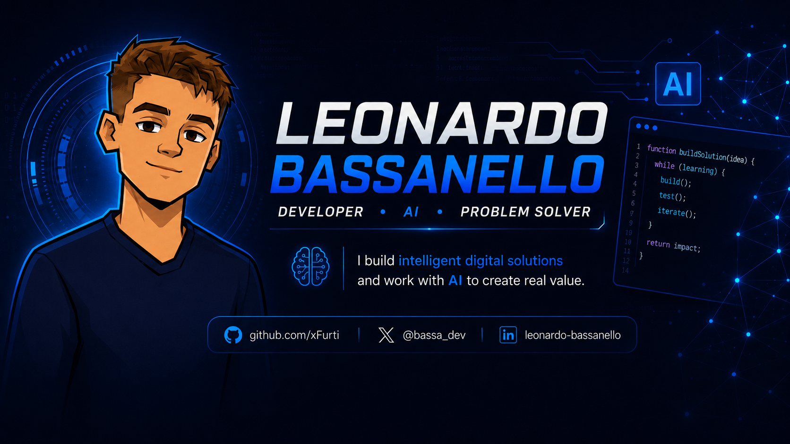

<!-- ====== HEADER / BANNER ====== -->
<div align="center">



# Hi there, I'm Leonardo 👋

### `< Developer />` &nbsp;•&nbsp; 🎓 Student &nbsp;•&nbsp; 🤖 AI Enthusiast


</div>
---

## 🚀 About Me

```python
class Leonardo:
    def __init__(self):
        self.name        = "Leonardo"
        self.role        = ["Developer", "Student"]
        self.school      = "Liceo Tecnologico Guglielmo Marconi, Verona 🇮🇹"
        self.passion     = "Artificial Intelligence 🤖"
        self.mindset     = "Always curious, always building"

    def current_focus(self):
        return ["Coding cool projects", "Exploring AI tools", "Learning everyday"]
```

- 🔭 &nbsp;I'm a **developer** and a **student** at *Liceo Tecnologico Guglielmo Marconi* in Verona
- 🤖 &nbsp;Deeply into **Artificial Intelligence** — love experimenting with new AI tools
- 🌱 &nbsp;Currently leveling up my skills across multiple languages & frameworks
- ⚡ &nbsp;Fun fact: I let AI handle the boring parts so I can focus on the cool ideas

---

## 🛠️ Tech Stack

<div align="center">


</div>

<div align="center">


</div>

> 💡 *I tend to pick the right tool for the job — and a bit of everything when I'm curious.*

---

## 🤖 AI Toolbox

The AI tools I use daily to code faster, learn smarter and create cooler things:

<div align="center">
    


</div>

---

## 📊 GitHub Stats

<div align="center">
    


</div>

<div align="center">


</div>

<div align="center">


</div>

---

## 🌐 Let's Connect

<div align="center">

[-000000?style=for-the-badge&logo=x&logoColor=white)](https://x.com/bassa_dev)
[](https://www.instagram.com/leonardo.bassa_/)
[](https://www.linkedin.com/in/leonardo-bassanello/)

</div>

---

<div align="center">

### 💬 *"Code, learn, repeat — and let the AI help along the way."*


⭐️ From [xFurti](https://github.com/xFurti)

</div>
